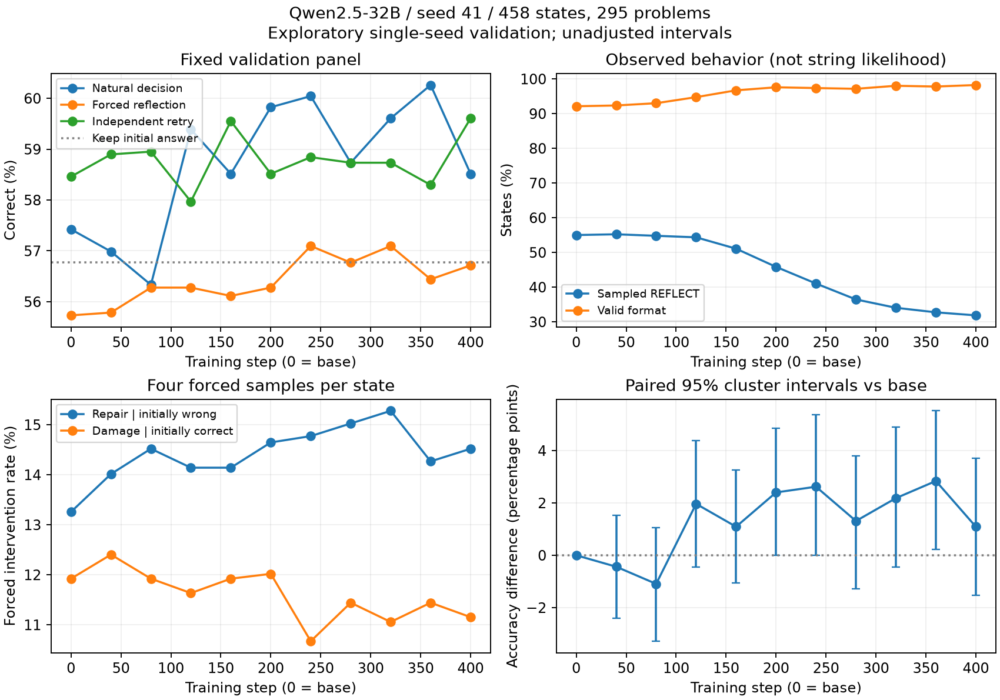

# 32B / seed 41 首轮实验归档（2026-10-19）

**400 步 GRPO 和 base + 10 个 checkpoint 的固定验证集评估全部完成。** 这是一次训练种子的探索性验证结果，尚不构成论文结论。MATH test、AIME、另外两个训练种子和 7B/14B 对照均未运行。

最终自然决策正确率从 **57.42%（263/458）到 58.52%（268/458）**，提升 1.09 个百分点；按原题聚类的配对 95% bootstrap 区间为 **[-1.52, +3.71] 个百分点**，不足以确认稳定准确率收益。采样反思率从 **55.02% 降至 31.88%**，格式有效率从 **92.14% 升至 98.25%**。当前最明确的变化是输出格式与反思频率，而非已证实的选择性纠错能力。

> **测量缺陷：原始 `p_reflect` 不是可用的自然动作概率。** 原实现分别编码 prompt 和无前导空格的动作字符串，漏掉了自然生成中常见的空格/换行形式及动作事件边界，并用原始 likelihood 与经过 temperature/top-p 的采样行为比较。原报告约 99.7% 的数值不能解释为“模型几乎全部反思”。本归档不发布以该数值为基础的 selectivity、policy utility、oracle regret 或跨 checkpoint 策略/执行矩阵；详见 [测量问题](MEASUREMENT_ISSUE.md)。历史运行代码仍保留此问题，尚未修复。



## 结果

所有 checkpoint 使用同一组 458 个初始状态，来自 295 道 validation 原题；状态间并非全部独立。每状态采样一次自然决策、四次强制反思及四次独立重试。无效自然输出计为错误。下列“纠错/损害”来自强制反思干预，不能当作自然策略实际纠错/损害频率。

| checkpoint | 自然正确率 | 实际采样反思率 | 格式有效率 | 强制纠错率¹ | 强制损害率² |
|---|---:|---:|---:|---:|---:|
| base | 57.42% | 55.02% | 92.14% | 13.26% | 11.92% |
| step40 | 56.99% | 55.24% | 92.36% | 14.02% | 12.40% |
| step80 | 56.33% | 54.80% | 93.01% | 14.52% | 11.92% |
| step120 | 59.39% | 54.37% | 94.76% | 14.14% | 11.63% |
| step160 | 58.52% | 51.09% | 96.72% | 14.14% | 11.92% |
| step200 | 59.83% | 45.85% | 97.60% | 14.65% | 12.02% |
| step240 | 60.04% | 41.05% | 97.38% | 14.77% | 10.67% |
| step280 | 58.73% | 36.46% | 97.16% | 15.03% | 11.44% |
| step320 | 59.61% | 34.06% | 98.03% | 15.28% | 11.06% |
| step360 | 60.26% | 32.75% | 97.82% | 14.27% | 11.44% |
| step400 | 58.52% | 31.88% | 98.25% | 14.52% | 11.15% |

¹ 对 198 个初始错误状态，四次强制反思中纠正成功的比例。² 对 260 个初始正确状态，强制反思后答错或格式无效的比例。

- step400 的强制反思正确率为 56.71%，独立重试为 59.61%；保留原答案为 56.77%。强制反思的净收益仍接近零。
- 自然输出平均生成长度由 88.41 降至 56.48 tokens；这不包括初始轨迹生成成本。不同策略的 token 预算不同，不能据此宣称等算力优势。
- step360 的自然正确率最高（276/458，60.26%），但这是在同一个验证集查看十次 checkpoint 后的事后最佳点。其未校正区间不能作为确认性显著性证据，不能报告为独立测试成绩。
- step400 相对 base 有 23 个状态从错变对，18 个从对变错，净多对 5 个。最终配对区间跨零。
- 训练奖励均值由前 50 步的 0.220 升至最后 100 步的 0.356；训练分布、采样设置与固定验证集不同，奖励增长不等同于验证能力增长。
- 在初始错误状态上，采样反思率由 67.68% 降至 47.47%；在初始正确状态上由 45.38% 降至 20.00%。这不等同于学会判断“是否可修复”，还需控制初始正确性、难度与输出格式进一步检验。

## 实验设置与完成证据

- 基础模型：`Qwen/Qwen2.5-32B`（Base），revision `1818d35814b8319459f4bd55ed1ac8709630f003`。
- 基础代码 commit：`6f2e91eb7d22bd65ab44b4815be823fa03878e1f`；实际运行增量见 `reproduction/source_delta.patch`，源文件哈希见 `provenance/source_sha256.json`。
- 硬件：单节点 **8 × A100-SXM4-80GB**，不是原手册所规划的 40GB 卡。ZeRO-3 CPU offload、BF16、SDPA、LoRA r=16/alpha=32/qkv+o。
- 训练：seed=41，600 状态/600 原题，micro batch=1、gradient accumulation=4、8 ranks，num_generations=4；400 步，每 40 步保存，学习率 2e-6，beta=0，无 vLLM。
- 训练集实际类别：recoverable 186、unresolved 133、fragile-correct 150、stable-correct 131。类别来自有限次训练侧探测，仅用于选样；奖励不直接使用类别/反思收益标签。
- 固定验证集从 300 道候选题经质量/状态构建筛选得到 295 题、458 状态，不能称为完整原始 MATH validation 分布；原始 test 未参与。
- 自然评估 temperature=0.7、top_p=0.95，最多 1024 新 tokens；训练最多 896 新 tokens。评估采样种子按状态/重复编号固定，详见历史代码。
- `provenance/status.json`：`seed41_validation_complete`；`training-success.json`：400 optimizer steps、world_size=8、success=true；阶段收据包括每个评估分片的输出哈希。
- 平台任务 `t-20261017083906-h7rv9` 于北京时间 2026-10-19 12:48:59 正常结束。归档的是个人存储修复后的续跑；此前失败发生于草稿数据准备，不是另一组独立训练结果。
- rank0 记录的训练单步均值约 151.67 秒，峰值 allocated memory 64.32 GiB。此值不是所有卡的最高显存，也不包含完整准备和评估时间。

## 本目录保留什么

- `observations.jsonl`：5,038 个 checkpoint-state 观测，仅保留 ID、判定、动作、token 数及四次干预的数值信息；不含题面、答案、生成文本或有缺陷的动作 likelihood。
- `checkpoint_metrics.{csv,json}`：11 个 checkpoint 的有效描述性指标，按训练步数排序。
- `paired_accuracy_vs_base.{csv,json}`：按原题聚类的配对准确率变化和区间。
- `training_metrics.jsonl` / `training_blocks.*`：完整 400 步数值训练记录及分段均值。
- `validation_curves.{png,pdf}`：可查看/导出的图；`recompute.py`：无 GPU 重算统计与图。
- `provenance/`：完成标记、数据和评估 manifest、原始分片 SHA256、阶段收据、硬件与训练配置。
- `reproduction/`：实际运行脚本、配置、相对原 commit 的源码补丁、归档日观测到的依赖版本。它们是历史执行记录，不能未经修正直接用于后续概率分析。

原始题目、完整轨迹、基础模型、adapter 权重和 optimizer checkpoint 保留在服务器存储，未上传 Git。文件位置见 [存储索引](STORAGE.md)。此归档支持从数值观测重算统计，但不能脱离原数据和模型重新评分答案或重跑推理。

## 重算与局限

```bash
python -m pip install numpy==2.4.6 matplotlib==3.11.2
python results/seed41-32b-20261019/recompute.py
```

配对区间使用 5,000 次原题聚类重采样、随机种子 41，每次保留题内全部状态，统计量按状态加权。区间仅描述当前固定生成观测在题目采样层面的不确定性，不包含独立训练种子方差，也不完整刻画重采样生成的不确定性。十次 checkpoint 比较未做多重检验校正。新生成的区间使用 5,000 次重采样，和原流程的 400 次区间不应逐值相等；143 项可比原始汇总数值已经独立重算并核对一致。

下一步应修正并验证动作事件概率定义、重算受影响统计，人工抽检判题与格式解析，之后再决定其他随机种子及独立测试集实验。当前证据不足以声称反思选择性涌现、相变或优于已有反思训练方法。
